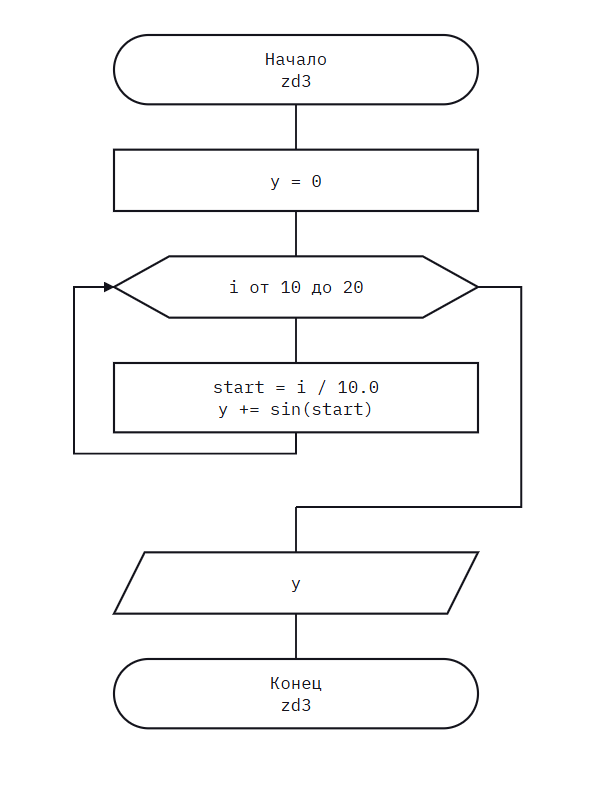

# Homework8

# Домашнее задание к работе 8

## Условие задачи
Вычислите с использованием цикла for значение: sin(1) + sin(1.1) + sin(1.2) + ... + sin(2)

## 1. Алгоритм и блок-схема

### Алгоритм

1. **Начало**

   - Программа создаёт переменную y со значением 0 для накопления суммы.
   - Запускается цикл for, где счётчик i последовательно принимает целые значения от 10 до 20 включительно (всего 11 итераций).

2. Вычисления в цикле (на каждом шаге)

   -  Переменная start получает вещественное значение: текущее i делится на 10.0 (получаются числа 1.0, 1.1, 1.2, ..., 2.0).
   - Вычисляется синус от start (в радианах).
   - Полученный результат прибавляется к общей сумме в переменную y.

3. **Вывод и завершение**

   - После окончания цикла итоговая сумма y выводится на экран в виде вещественного числа.
   - Программа возвращает 0 и завершает работу.

### Блок-схема
 


## 2. Реализация программы

```#define _CRT_SECURE_NO_DEPRECATE
#include <stdio.h>
#include <locale.h>
#include <math.h>

int zd3();

int main() {
	setlocale(LC_CTYPE, ".UTF-8");

	zd3();

	return 0;
}

int zd3() {

	double y = 0;

	for (int i = 10; i <= 20; i++) {

		double start = i / 10.0;
		y += sin(start);
	}
	printf("%f", y);
	return 0;
}
```

## 4. Информация о разработчике

Медведкин Артём Александрович группа бТИИ-262
